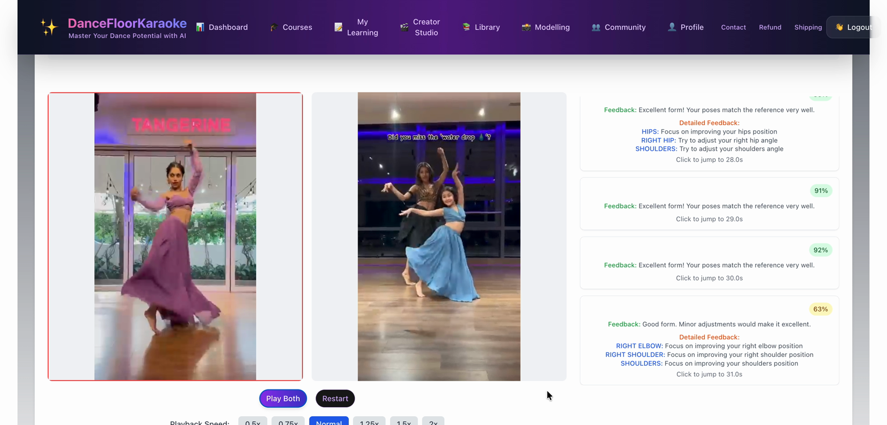
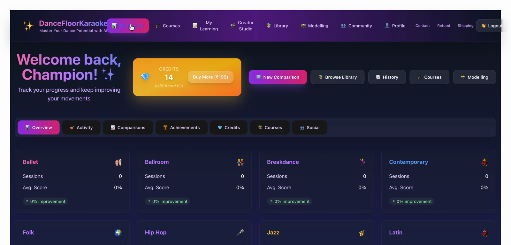
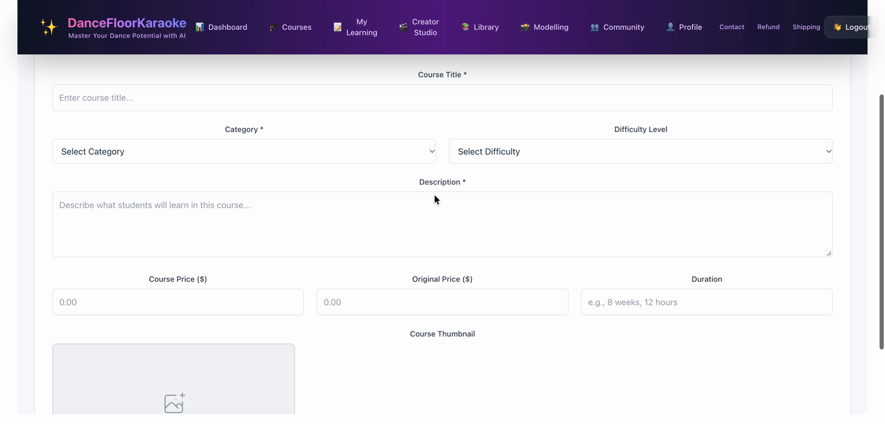
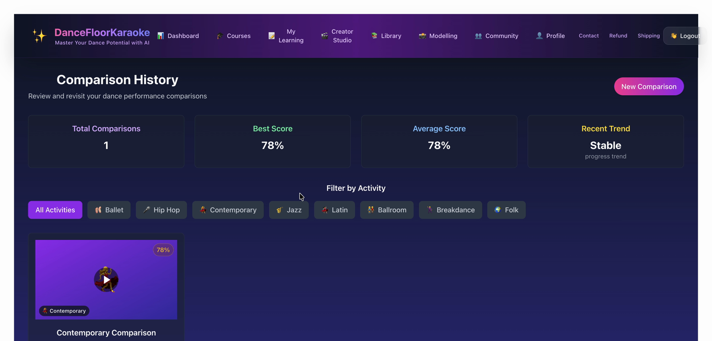
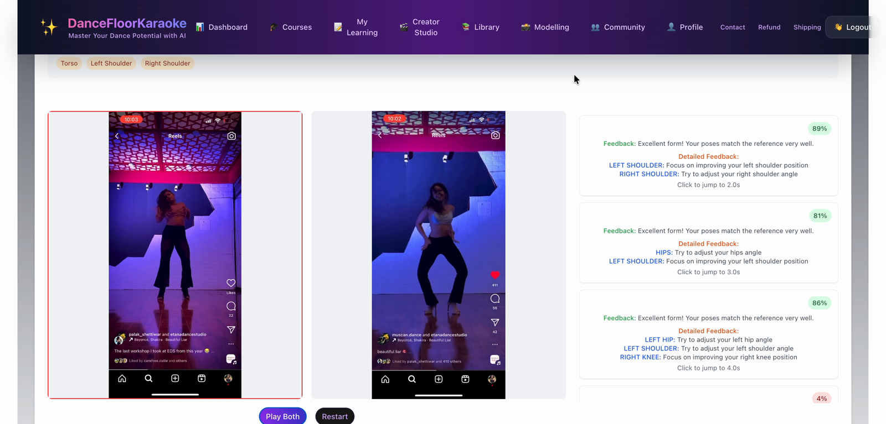
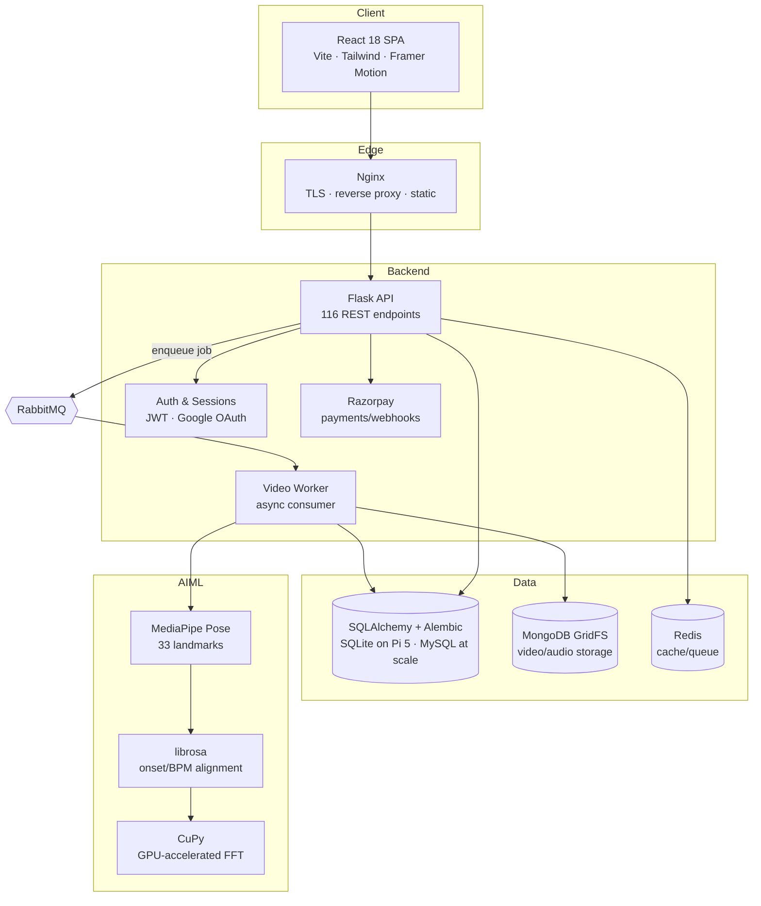

<div align="center">

# 💃 DanceFloorKaraoke

### AI-powered dance analysis, courses & social learning platform

Turn any reference dance video into personalized, frame-by-frame coaching — powered by AI pose estimation and audio-aligned motion comparison.

[](https://dancefloorkaraoke.com)

[](#tech-stack)
[](#tech-stack)
[](#tech-stack)
[](#tech-stack)
[](#tech-stack)
[](#tech-stack)

</div>

---

> **Note:** This is a **showcase repository**. The production source code is private. This repo documents the system design, architecture, and product so reviewers can evaluate the work. Screenshots and a demo recording are included.

<!--
  📸 Replace the placeholder below with a short demo GIF/MP4.
  Keep it < 10 MB and ~15-30 seconds (GitHub inlines MP4s and small GIFs).
-->
<div align="center">

<video src="assets/demo/demo.mp4" controls playsinline width="100%"></video>

*Dashboard, then two comparisons with live technique scores.*

</div>

---

## 📖 Overview

**DanceFloorKaraoke** is a full-stack platform where users learn choreography by dancing along to real videos and receiving objective, quantified feedback. A user picks a reference dance, records or uploads their attempt, and the system returns a **technique score, per-body-part breakdown, and synchronized side-by-side playback** — all automatically.

It grew into a complete social learning product: courses, creators, a credits/paid content system, notifications, leaderboards, and an admin analytics console.

**Live product:** [dancefloorkaraoke.com](https://dancefloorkaraoke.com)

---

## ✨ Key Features

| Area | What it does |
|------|--------------|
| **AI motion comparison** | Compares a user video against a reference clip frame-by-frame using MediaPipe pose landmarks — 33 keypoints per frame. |
| **Audio-driven sync** | Aligns the two videos by analyzing the audio track (onset/BPM via librosa) before comparing motion, so differently-timed uploads still line up. |
| **Scoring engine** | Produces a 0–100 score plus per-region feedback (arms, torso, legs, timing) and overlays the reference pose on the user's video. |
| **Courses & creators** | Users create and sell dance courses with lessons, video uploads, previews, and enrollment analytics. |
| **Social layer** | Follows, likes, comments, notifications, achievements, and a leaderboard. |
| **Credits & payments** | Credit bundles and course purchases via Razorpay, with webhook verification and transaction history. |
| **Auth** | Email/password (bcrypt) + Google OAuth, JWT sessions, email-based password reset. |
| **Admin console** | User/role management, content moderation, real-time traffic stats, and CSV exports. |

<!--
  📸 Drop 3-5 screenshots into assets/screenshots/ and reference them here.
  The recording has no admin console, so the fourth still is comparison history.
-->
<div align="center">

| Video Comparison | Dashboard |
|:---:|:---:|
|  |  |

| Course Creator | Comparison History |
|:---:|:---:|
|  |  |

| Region scores |
|:---:|
|  |

</div>

---

## 🏗️ Architecture



**Processing pipeline for a single comparison:**

1. Client uploads the user video → stored in MongoDB GridFS.
2. API enqueues a job on **RabbitMQ** and returns immediately (non-blocking).
3. Worker pulls the job, extracts frames with **OpenCV**, and aligns the two clips using **librosa** audio analysis.
4. **MediaPipe** extracts 33 pose landmarks per frame for both videos.
5. Landmarks are normalized, compared, and scored; a **CuPy** path accelerates the FFT-heavy audio work on GPU.
6. Results are persisted and streamed back to the client as a synchronized side-by-side view.

See [`docs/architecture.md`](docs/architecture.md) for the deeper walkthrough and [`docs/technical-highlights.md`](docs/technical-highlights.md) for the interesting engineering problems.

---

## 🛠️ Tech Stack

| Layer | Technologies |
|-------|--------------|
| **Frontend** | React 18, Vite, Tailwind CSS, Framer Motion, React Router, Chart.js, react-oauth/google |
| **Backend** | Python, Flask, SQLAlchemy, Alembic, Gunicorn, gevent |
| **AI / ML** | MediaPipe Pose, OpenCV, NumPy, librosa, SoundFile, CuPy (GPU), PyTorch (GPU detection) |
| **Data** | SQLite on a Raspberry Pi 5, MySQL if deployed at scale, MongoDB (GridFS), Redis |
| **Messaging** | RabbitMQ (async video-processing queue) |
| **Infra / DevOps** | Docker & Docker Compose, Nginx, Raspberry Pi deployment |
| **Integrations** | Google OAuth, Razorpay, SMTP email |

---

## 🔬 Engineering Highlights

- **Async video pipeline** — moving heavy CV work off the request path onto RabbitMQ workers keeps the API responsive under load.
- **Audio-aligned motion comparison** — naive frame-by-frame diffing breaks when the user starts late or the tempo drifts; onset/BPM alignment fixes it.
- **GPU acceleration with graceful fallback** — detects GPU capabilities at startup, auto-tunes batch size to VRAM, and falls back to CPU cleanly.
- **Portable deployment** — runs identically via Docker Compose (Redis/Nginx/DB) and on a low-power Raspberry Pi for edge demos.
- **Benchmarked on edge hardware** — a full comparison (audio sync + MediaPipe pose over **920 frames**) completes in **~5 minutes on a Raspberry Pi 5**.
- **Structured logging** — component-scoped loggers (API/auth/video/db/payments) with size-based rotation, mirrored client-side.

<details>
<summary>📐 Scale at a glance</summary>

- **~116** REST endpoints across auth, video, courses, social, admin, and payments
- **~33** tracked pose landmarks compared per frame
- **920 frames** (audio sync + pose) processed in **~5 min on a Raspberry Pi 5**
- Stack span: Flask backend · React SPA · AI pipeline · infra

</details>

---

## 📁 About This Repository

```
fitness-genie-showcase/
├── README.md                       # this file
├── docs/
│   ├── architecture.md             # system design deep-dive
│   └── technical-highlights.md     # notable engineering decisions
└── assets/
    ├── screenshots/                # product screenshots
    └── demo/                       # demo GIF / video
```

Only documentation and demo media are published here. The application source remains private.

---

## 👤 Authors

**Radheya Kale** — React frontend, Flask API, the MediaPipe/OpenCV comparison engine, async workers, payments, and deployment.

**Nilam Deshpande** — React frontend.

🌐 Live: [dancefloorkaraoke.com](https://dancefloorkaraoke.com)
